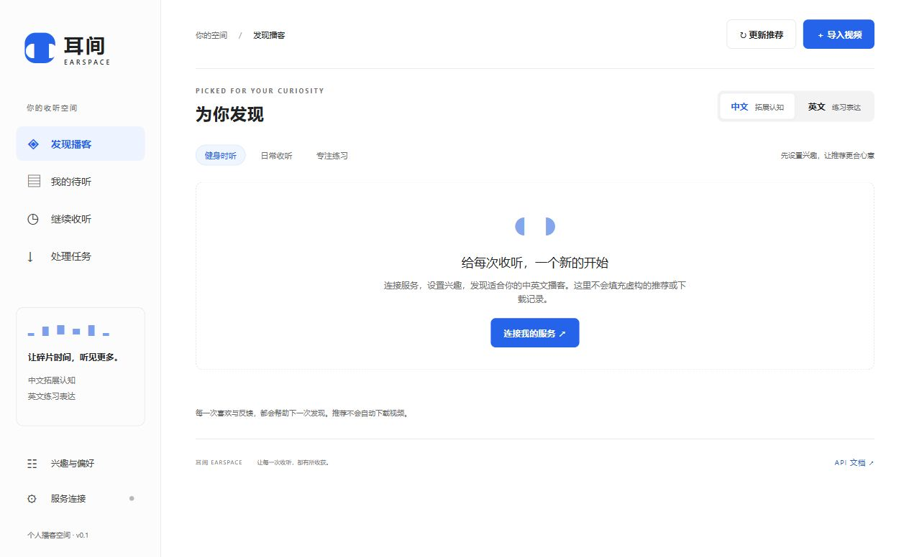

# 耳间 Earspace

**个人自托管的双语播客助手：按喜好发现 YouTube 内容，下载音频，配合文稿收听与练习。**

中文补充知识，英文练习听力与表达。包含 Python API、独立后台 Worker，以及同源部署的网页测试界面。默认只下载音轨并生成 M4A；需要观看时可以选择 MP4 模式。



## 本机测试（uv）

安装 [uv](https://docs.astral.sh/uv/getting-started/installation/)（0.10.4+）、FFmpeg／ffprobe 和 Node.js 22+，在项目根目录执行：

```bash
uv sync --locked
uv run --locked scripts/init_env.py
# 编辑 .env，填写 YOUTUBE_API_KEY；保留 EARSPACE_API_KEY
uv run --locked uvicorn app.main:app --host 127.0.0.1 --port 8000 --no-access-log
```

在另一个终端进入同一个目录，运行后台任务服务：

```bash
uv run --locked python -m app.worker
```

打开 <http://127.0.0.1:8000/>，输入 `.env` 中的 EARSPACE_API_KEY。两个终端都需保持运行，停止时分别按 Ctrl+C。uv 根据 `.python-version` 使用 Python 3.12，并自动管理 `.venv`，不需要手动激活环境；默认不安装 Whisper。更多命令见 [本机开发](docs/DEVELOPMENT.md)。

## 快速部署

需要 Linux、Docker Engine + Compose 插件、uv，以及能访问 Google APIs、YouTube 和软件源的服务器。仓库为私有，需要先配置有读取权限的 GitHub SSH Key 或 HTTPS 凭据。宿主机 uv 仅用于初始化配置，容器内使用 `uv.lock` 安装应用。

```bash
git clone git@github.com:AnthonyayaPZ/earspace-podcast.git
cd earspace-podcast
uv run --no-project --python 3.12 scripts/init_env.py
# 编辑 .env，填写 YOUTUBE_API_KEY；保留生成的 EARSPACE_API_KEY
docker compose up -d --build --wait --wait-timeout 180
docker compose logs --tail 100 api worker
```

默认仅监听服务器本机 `127.0.0.1:8000`。在自己的电脑建立隧道：

```bash
ssh -N -L 8000:127.0.0.1:8000 your-user@your-server
```

打开 <http://127.0.0.1:8000/>，输入服务器 `.env` 中的 EARSPACE_API_KEY。API 文档在 `/docs`。完整步骤、域名、备份、更新和排错见 [服务器部署](docs/DEPLOYMENT.md)。

## 接入 YouTube 与开始收听

1. 在 Google Cloud 项目启用 YouTube Data API v3，创建 API Key，填入服务器 `.env` 的 `YOUTUBE_API_KEY`。
2. 执行 `docker compose up -d --force-recreate` 加载配置。
3. 网页设置兴趣、英语水平、收听时长、可选频道 ID，点击“更新推荐”。
4. 等发现任务完成，选择中英文节目并点击“准备收听”，默认仅下载音轨。
5. 下载完成后开始播放、查看文稿，或点击“音频 ↓”保存 M4A。

Google API 负责公开内容检索与元数据；推荐在本应用中排序；音轨由 yt-dlp 获取并通过 FFmpeg 处理。**Google API Key 与用于登录本应用的 EARSPACE_API_KEY 是两个不同密钥。** [接入文档](docs/YOUTUBE.md) 提供控制台步骤、推荐原理，以及检索 → 查询任务 → 推荐 → 音频下载的 curl 示例。

## 功能

- 兴趣、频道、显式反馈、时长和每日探索组成的可解释推荐，附推荐理由。
- 中英文分区、待听列表、继续收听、倍速、睡眠定时、逐句循环。
- 默认 `mode=audio` 获取独立音轨；AAC 直接复制为 M4A，保留原码率，其他编码才单线程转换为 AAC 96 kbps；`mode=video` 额外准备 MP4。
- 相应语言人工字幕优先，其次自动字幕；支持时间戳 JSON 导入和 VTT／TXT 导出。
- 自动按句整理字幕，跨片段合并／句中拆分；高亮、跳转与循环共用句子边界。旧文稿可直接“重新整理”，保留原始字幕，无需重新下载音频。
- 遇到 YouTube 登录验证时，可选配置自行导出的 Cookie 文件；源文件不被修改，临时副本只保留 YouTube Cookie。
- 可选 faster-whisper CPU 转写，不因缺字幕而自动运行。
- SQLite 持久化任务，去重、退避重试、取消、Worker 租约恢复、媒体任务互斥。
- Bearer 鉴权、Range 媒体播放、短期签名播放链接、来源明确的 CORS。

## 文档

| 文档 | 内容 |
| --- | --- |
| [服务器部署](docs/DEPLOYMENT.md) | 克隆、配置、Docker、SSH 访问、HTTPS、运维与排错 |
| [YouTube 接入](docs/YOUTUBE.md) | API Key、内容发现、推荐原理、仅音频下载、网络边界 |
| [API 参考](docs/API.md) | 接口、鉴权、反馈与文稿格式 |
| [句子与循环](docs/TRANSCRIPTS.md) | 断句算法、时间精度、同步循环与旧文稿重建 |
| [开发与架构](docs/DEVELOPMENT.md) | 本机启动、任务结构、测试、依赖与发行包 |

## 当前边界

这是单用户 MVP。推荐为规则排序，不调用大模型，也不读取个人 YouTube 首页／观看历史。英文难度仅在文稿充足时做语速／词汇粗估，不是 CEFR 或发音评测。语言缺少元数据时会标注推断。

尚未实现多账户、YouTube 账号同步、自动定时发现、全文翻译、AI 摘要、口语评分与手机离线 App。手机网页后台播放由浏览器决定；可下载 M4A 后使用设备播放器。

只处理你有权下载、保存和转写的内容。服务器 IP、地区限制、登录要求或 YouTube 变动可能影响下载。默认匿名获取；可通过 `EARSPACE_YOUTUBE_COOKIES_FILE` 指定自行导出的登录会话，不自动读取浏览器会话或完成验证码。配置方式见 [登录验证排错](docs/YOUTUBE.md#六youtube-登录验证与-cookie-文件)。

项目不会提交 `.env`、数据库、Cookie、媒体文件或虚拟环境。运行数据保存在 Docker 命名卷；`docker compose down` 保留数据，避免误用 `down -v`。

只需标题、已有字幕和音频时，保持仅音频模式、一个 Worker、`EARSPACE_WHISPER_ENABLED=false`。这条路径以网络和存储开销为主，不需要 GPU 或本地语音模型。低配置运行建议见 [部署文档](docs/DEPLOYMENT.md#低配置服务器)。
